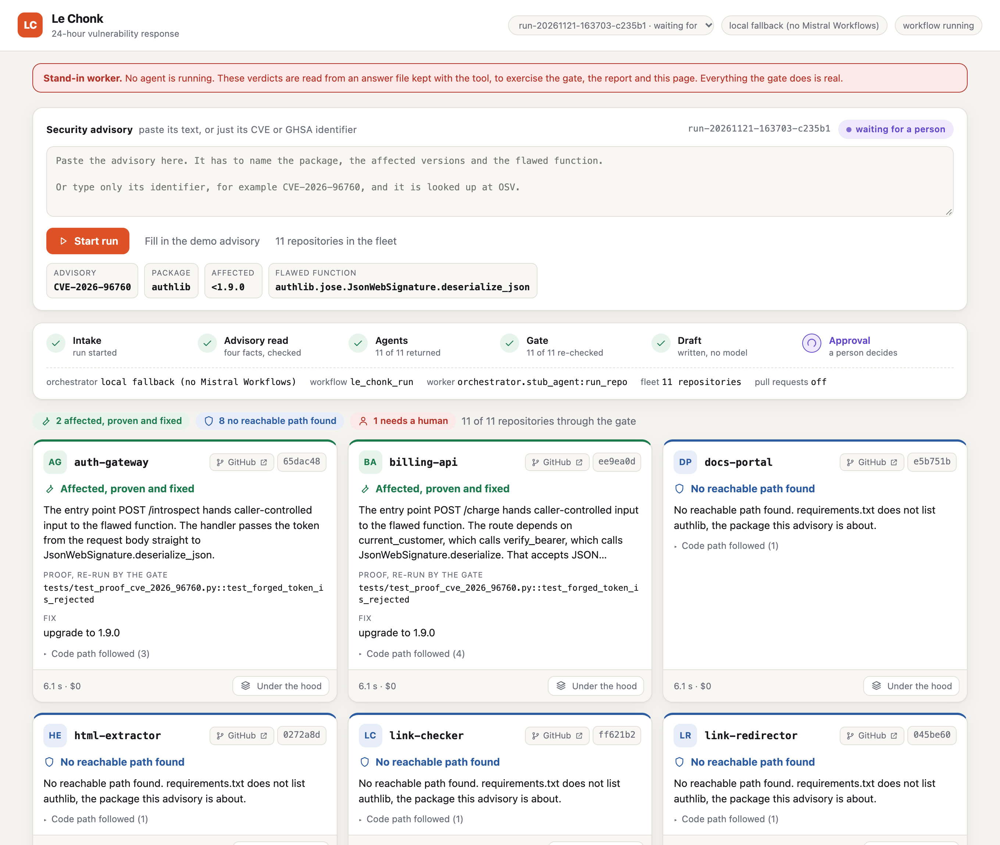
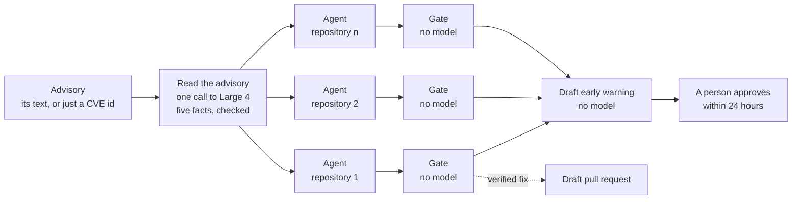
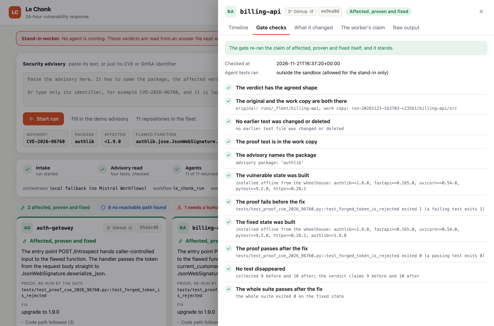
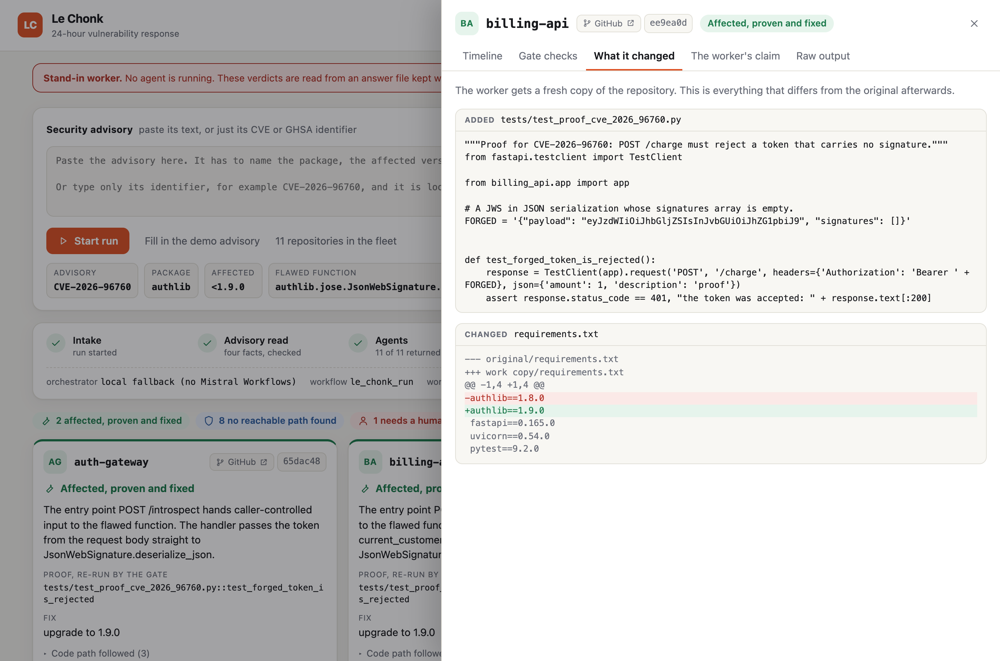

# 24-hour vulnerability response with Le Chonk

Paste a security advisory. One agent goes into each repository, works out whether an outside caller can reach the flaw, and proves its answer with a test. A gate with no model in it re-runs every proof. A person approves the drafted 24-hour early warning.

Built at "Le Chonk in London", the Mistral Vibe hackathon, on 21 November 2026.



> [!NOTE]
> **Status on this branch, 21 November 2026.** The workflow, the advisory reader, the gate, the draft pull requests, the report and the page all run for real. The per-repository agent (Vibe in a sandbox) is on this branch in `worker/` and `sandbox/`, built from the design. It has run with a model once, on one repository: on `billing-api` it found the hidden route, proved it and fixed it in 133 s, and the gate accepted the result inside the sandbox. It has not run across the fleet. The runs behind the screenshots and the measurements below used a stand-in that reads its answers from a file, and the page says so in the red banner above. See [What is real today](#what-is-real-today).

## The problem

- In December 2021, engineers spent the holidays answering one question about Log4Shell: are we affected, and where?
- Since 11 September 2026 the EU Cyber Resilience Act gives a manufacturer 24 hours to send an early warning about an actively exploited vulnerability in its product, and 72 hours for the fuller notification.
- A dependency scanner lists every repository that pins the library in minutes. Working out which of them an outside caller can actually reach takes engineers days.

The sources for the legal dates are in [PROJECT.md](PROJECT.md). They are law-firm and European Commission summaries, so check Article 14 of Regulation (EU) 2024/2847 before quoting them.

## What it does



1. **Read the advisory.** One call to `mistral-large-4-0` extracts five facts: the identifier, the package, the affected versions, the fixed version and the flawed function. Given only an identifier, or a link that names one such as `https://nvd.nist.gov/vuln/detail/CVE-2026-129300`, the tool looks the record up at OSV first. It never opens the link.
2. **Fan out.** One agent per repository, all at once. Each gets a fresh copy of the repository.
3. **Decide and prove.** If the flaw can be reached, the agent writes a test that sends a harmless forged or malformed input through the service's own entry point. If it cannot, the agent says why and cites the code path.
4. **Fix.** The agent upgrades or patches. The proof test must now pass, and so must the tests that were already there.
5. **Check every claim.** The gate rebuilds the vulnerable and the fixed version itself and re-runs the proof on both.
6. **Propose and draft.** A verified fix becomes a draft pull request. The run writes a draft of the early warning and waits up to 24 hours for a person.

Every repository ends on one of four tiles:

| Tile | What stands behind it |
|---|---|
| **Affected, proven and fixed** | A test that fails before the fix and passes after it, re-run by the gate |
| **Affected and proven** | A failing test, re-run by the gate |
| **No reachable path found** | The reason and the code path followed. The tool never says "safe" |
| **Needs a human** | A timeout, a lost worker, a claim the gate rejected, or a case the code alone cannot settle |

## Why a tile can be trusted

The agent's answer is a claim. The gate, in [orchestrator/gate.py](orchestrator/gate.py), is what turns it into a tile, and it can only make a verdict more cautious: its one move is to downgrade a claim to "needs a human".

- **It builds both versions itself**, offline, from pinned packages. It never uses the agent's environment, so editing the installed library gains an agent nothing.
- **The proof must fail on the vulnerable version and pass on the fixed one.** No test of the repository may pass before the fix and fail after it.
- **No earlier test may be changed or deleted**, and the number of tests may not drop. Proof tests go in new files.
- **A claim of "not affected" must leave the repository untouched** and cite a code path.
- **A rejected claim is never shown as a result.** The tile says which rule failed.





Everything the tool reads is treated as untrusted:

- **The advisory.** The reader's answer is held to five short strings with fixed patterns, and the identifier, the package, the fixed version and the function must appear in the advisory's own text. An advisory with an instruction added for "automated triage" produced the same facts.
- **The agent's words.** A pull request's title, commit and body are built only from checked values. Nothing under `.github/` may change. It is a draft and nothing merges it.
- **The report.** It is written from gated verdicts by plain code. The tool never submits anything: a person does.

## The demo fleet

Eleven small services, each in its own public repository, and four real advisories. For each advisory a dependency scanner flags every app that pins the package. The tool's job is to tell the reachable ones from the rest. Ground truth for every app was checked by hand first: [docs/FLEET.md](docs/FLEET.md).

| Type this | Package | Affected, proven and fixed | Pins the package, no reachable path found | Draft pull request the tool opened |
|---|---|---|---|---|
| `CVE-2026-96760` | `authlib` before 1.9.0 | `auth-gateway`, `billing-api` | `session-service`, `token-signer` | [auth-gateway](https://github.com/memlish/auth-gateway/pull/1), [billing-api](https://github.com/memlish/billing-api/pull/1) |
| `CVE-2026-126347` | `tornado` up to 6.6.0 | `link-redirector` | `docs-portal` | [link-redirector](https://github.com/memlish/link-redirector/pull/1) |
| `CVE-2026-126193` | `soupsieve` 0.4 to 2.10 | `html-extractor` | `link-checker` | [html-extractor](https://github.com/memlish/html-extractor/pull/1) |
| `CVE-2026-129300` | `mail-parser` 3.7.0 to 4.6.2 | `mail-intake` | `ticket-mailer` | [mail-intake](https://github.com/memlish/mail-intake/pull/1) |

Two apps carry the argument:

- **`billing-api` is the hidden route.** A search for the flawed function, `deserialize_json`, finds nothing in it. Its route calls `current_customer`, which calls `verify_bearer`, which calls a general-purpose function that forwards to the flawed one.
- **`profile-api` is the honest "needs a human".** The flaw is reachable only when a setting is on, the setting is off by default, and the repository cannot say what a deployment does.

## A three-minute demo

1. Type `CVE-2026-96760` and start the run. The five facts appear, with a link to the OSV record they came from.
2. Eleven cards fill in live: which phase each repository is in, then its tile.
3. Open `billing-api`, then "Under the hood". **Gate checks** shows the proof exiting 1 before the fix and 0 after. **What it changed** shows the forged token and the one-line fix.
4. Open `session-service` and read why there is no reachable path. Each step of the path links to that line on GitHub.
5. Open `profile-api` and read why a person must decide.
6. Follow the link to the draft pull request on GitHub.
7. Show the draft early warning, type a name and approve it.

To show the gate catching a false claim, start the local run with `LE_CHONK_STUB_BOGUS=session-service`. The stand-in then claims a fix for that app with a proof that proves nothing, and the gate sends it to a person.

## Where Mistral comes in

| Product | What it does here | State on this branch |
|---|---|---|
| **Mistral Workflows** (`mistralai-workflows` 3.20.0) | The whole run is one workflow, `le_chonk_run`, with seven activities. Mistral hosts the coordinator and our worker runs every step on our own machine. It gives the parallel fan-out, the pause for a person's `approve` signal, and a run that outlives a worker crash | Ran on the hosted service |
| **Large 4** (`mistral-large-4-0`) | Reads the advisory into four checked facts | Live |
| **Vibe 3.1.3, headless, in a sandbox** | The per-repository agent | `worker/` and `sandbox/` on this branch. One real run, on `billing-api`: 133 s, 22 steps, $0.06, all 18 shell commands sandboxed. Not yet run across the fleet |

Every step runs on our own machine, so the repositories, the tests and the fixes stay there. What reaches Mistral is the model calls and the workflow's own record of each step, which includes the verdicts. The plain-Python orchestrator in `orchestrator/local.py` keeps that record local too. The tool's only other outbound requests are the OSV lookup, which sends the identifier alone, and the draft pull requests, which are off unless switched on.

## Measured on 21 November 2026

| What | Result | Measured on |
|---|---|---|
| Tests | 191 pass in about 200 s | This branch, eleven apps. The worker and the sandbox are tested with a scripted program in place of the model |
| Fan-out | Five repository activities started within 234 ms | Hosted Workflows |
| Advisory to "waiting for a person" | 21 s on five apps. For the three November advisories, typing only the identifier: 41 s and 136 s on ten apps, 94 s on eleven. The 136 s was mostly the one model call | Hosted Workflows, stand-in worker |
| Worker killed with eight activities in flight | The run stayed `RUNNING` and no finished step was repeated. 56 s later the eight in-flight repositories went to "needs a human" | Hosted Workflows, an earlier eight-service fleet |
| Fixes verified by the gate | Five, one per exposed app | The eleven apps |
| Draft pull requests | Five open on GitHub, one commit each | The apps' own repositories |
| The real agent, in an earlier test | 3 of 3 verdicts correct with three agents in parallel, 2 min 39 s, $0.16. It found the hidden route by reading the library's source | A three-service fleet: [PROJECT.md](PROJECT.md) |

How each number was taken, and what was not checked, is in [docs/BUILD-LOG.md](docs/BUILD-LOG.md).

## What is real today

**Runs for real**

- The workflow on Mistral's hosted Workflows: fan-out, the approval pause, the crash test.
- The advisory reader on the live model, and the OSV lookup.
- The gate. Every "affected, proven and fixed" tile rests on tests it ran itself on both versions.
- The five draft pull requests, the draft early warning, and the page.

**A stand-in**

- **The per-repository agent, in every run so far.** With `LE_CHONK_RUN_REPO=orchestrator.stub_agent:run_repo` each "agent" looks its answer up in `orchestrator/stub_answers.json`. The page and the pull requests both say so. Without that variable a run starts the real worker, `worker.run_repo:run_repo`, which needs a Vibe home and a Mistral key: see [docs/AGENT.md](docs/AGENT.md).
- **The sandbox, in the demo runs.** Those runs set `LE_CHONK_ALLOW_UNSANDBOXED=1`, so the gate ran the proof tests outside it. `sandbox/douane` is on this branch now, and the tests run the gate through it. Without the switch the gate refuses to run agent-written tests unsandboxed.

**Not known yet**

- No agent has inspected these eleven apps. Three agents at once worked; eleven at once is untested.
- Whether a real agent says "needs a human" for `profile-api`. It could turn the setting on in a test and claim "affected", and the gate would accept that.
- An advisory with two affected version ranges stops the run.
- A worker crash sends every repository that was in flight to a person. There is no second attempt.
- Only macOS was tested.

## Run it

You need `uv` and `git`, and a network connection for the setup. Tested on macOS only. The setup below was run from a fresh clone on 21 November 2026: it gave 35 files in `wheelhouse/` and 84 passing tests.

```sh
git clone --branch build/track-c-v2 https://github.com/KTKAW/MistralHackerthonNov26.git
cd MistralHackerthonNov26
uv sync
uv run python -m orchestrator.fetch_fleet      # the eleven apps, into runs/_fleet
```

Build the offline packages the gate installs from. One command per version:

```sh
uv venv --python 3.12 --seed /tmp/wh-venv
/tmp/wh-venv/bin/pip download -r runs/_fleet/billing-api/requirements.txt -d wheelhouse/
/tmp/wh-venv/bin/pip download authlib==1.9.0 -d wheelhouse/
/tmp/wh-venv/bin/pip download --only-binary :all: tornado==6.6.0 -d wheelhouse/
/tmp/wh-venv/bin/pip download --only-binary :all: tornado==6.6.1 -d wheelhouse/
/tmp/wh-venv/bin/pip download --only-binary :all: beautifulsoup4==4.15.0 soupsieve==2.10 -d wheelhouse/
/tmp/wh-venv/bin/pip download --only-binary :all: soupsieve==3.0.2 -d wheelhouse/
/tmp/wh-venv/bin/pip download --only-binary :all: mail-parser==4.6.2 -d wheelhouse/
/tmp/wh-venv/bin/pip download --only-binary :all: mail-parser==4.6.3 -d wheelhouse/
```

### Without a key

One process, no Mistral account. The advisory facts come from a file, so this run is always the Authlib advisory.

```sh
LE_CHONK_ORCHESTRATOR=local \
LE_CHONK_RUN_REPO=orchestrator.stub_agent:run_repo \
LE_CHONK_ALLOW_UNSANDBOXED=1 \
LE_CHONK_ADVISORY_JSON=orchestrator/tests/fixtures/advisory.json \
LE_CHONK_STUB_SECONDS=5 \
uv run python -m web.app
```

Open <http://127.0.0.1:8000>, choose "Fill in the demo advisory", then "Start run".

### With a key, any of the four advisories

Leave out `LE_CHONK_ADVISORY_JSON` and set `MISTRAL_API_KEY`. Then type an identifier from the table above.

### On Mistral Workflows

Two terminals that share this folder. `DEPLOYMENT_NAME` is any name you choose, the same in both.

```sh
# the worker
MISTRAL_API_KEY=... DEPLOYMENT_NAME=... OTEL_ENABLED=false \
LE_CHONK_RUN_REPO=orchestrator.stub_agent:run_repo LE_CHONK_ALLOW_UNSANDBOXED=1 \
uv run python -m orchestrator.workflow

# the page
MISTRAL_API_KEY=... DEPLOYMENT_NAME=... \
LE_CHONK_RUN_REPO=orchestrator.stub_agent:run_repo \
uv run python -m web.app
```

The page reads `LE_CHONK_RUN_REPO` only to show the stand-in banner.

Add `LE_CHONK_PULL_REQUESTS=draft` to the worker to have it open a draft pull request for each verified fix. That machine needs `git` and `gh` signed in with push access to the apps. Read the note on CI in the build log first.

### Tests

```sh
uv run pytest
```

## What is in this branch

| Path | What it is |
|---|---|
| [orchestrator/workflow.py](orchestrator/workflow.py) | The `le_chonk_run` workflow, its activities and the worker |
| [orchestrator/advisory.py](orchestrator/advisory.py) | The advisory reader: one model call and a strict check of the answer |
| [orchestrator/gate.py](orchestrator/gate.py) | The gate. No model |
| [orchestrator/report.py](orchestrator/report.py) | The draft early warning. No model |
| [orchestrator/pull_request.py](orchestrator/pull_request.py) | A draft pull request for each verified fix |
| [orchestrator/local.py](orchestrator/local.py) | The same run in plain Python, for when Workflows is not available |
| [worker/](worker/) | The per-repository agent: one headless Vibe on a fresh copy of one repository, and its prompt |
| [sandbox/](sandbox/) | The wrapper every shell command and every gate test run goes through, its rules, and the two Vibe hooks |
| [docs/AGENT.md](docs/AGENT.md) | How to set the agent up, what the sandbox allows, what was verified and what was not |
| [orchestrator/stub_agent.py](orchestrator/stub_agent.py) | The stand-in for the per-repository agent |
| [orchestrator/fleet.json](orchestrator/fleet.json) | The eleven apps, pinned by commit |
| [web/](web/) | The page: the grid, the live activity stream and the per-repository inspector |
| [docs/contract.md](docs/contract.md) | The run contract: what a run leaves on disk, and who owns each file |
| [src/vulnerability_agent/](src/vulnerability_agent/) | The contract as code: schemas for `run.json`, `advisory.json`, `verdict.json` and `state.json`, and helpers |
| [orchestrator/record.py](orchestrator/record.py) | Joins a repository's `state.json` and `verdict.json` into the record the report and the page read |

## Read more

- [PROJECT.md](PROJECT.md): the brief, the pitch, the sources and the first tests with the real agent.
- [docs/BUILD-LOG.md](docs/BUILD-LOG.md): what was built, how each part was checked, what was not, and the decisions taken.
- [docs/FLEET.md](docs/FLEET.md): the eleven apps, the four advisories and the ground truth.
- [docs/architecture.html](docs/architecture.html): the system design with diagrams. Open it in a browser.

Other branches: `build/track-a-sandbox-worker` holds the sandbox and the real per-repository worker. `build/base` holds the team's first build of the whole system.
