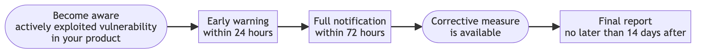
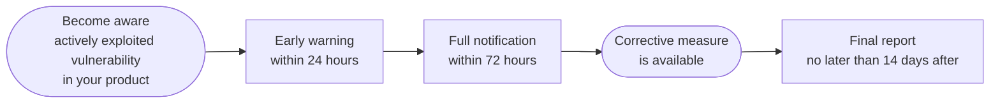

# The CRA reporting clock

**Definition:** The EU *Cyber Resilience Act* (CRA) makes manufacturers report two things about their products with digital elements: actively exploited vulnerabilities, and severe incidents. The first report is the *early warning*. Reports go through the *Single Reporting Platform* that ENISA runs. [Commission on CRA reporting, Sep 2026](../sources/european-commission-cra-reporting.md)

This page is a summary for engineers. It is not legal advice.

## Why it matters

The duty has applied since 11 September 2026, and its first deadline is 24 hours from becoming aware. [Commission on CRA reporting, Sep 2026](../sources/european-commission-cra-reporting.md) Working out which products are actually affected by a library's flaw takes engineers days. [Project brief, Nov 2026](../sources/team-project-brief.md) So the answer has to exist, or be producible, inside a day.

## The clock

Diagram source (Mermaid)

| Step | Deadline |
|---|---|
| Early warning | Within 24 hours of becoming aware |
| Full notification | Within 72 hours |
| Final report, for a vulnerability | No later than 14 days after a corrective measure is available |
| Final report, for a severe incident | Within one month of the 72-hour notification |

All four rows are from the Commission's page. [Commission on CRA reporting, Sep 2026](../sources/european-commission-cra-reporting.md)

## What to do

- Record the moment you became aware. The 24 hours run from there. [Commission on CRA reporting, Sep 2026](../sources/european-commission-cra-reporting.md)
- Send the early warning within 24 hours and the full notification within 72 hours. [Commission on CRA reporting, Sep 2026](../sources/european-commission-cra-reporting.md)
- Send the final report no later than 14 days after a corrective measure is available. [Commission on CRA reporting, Sep 2026](../sources/european-commission-cra-reporting.md)
- File once, through the Single Reporting Platform. The notification goes to the CSIRT of the country where the manufacturer has its main establishment, and ENISA receives it at the same time. [Commission on CRA reporting, Sep 2026](../sources/european-commission-cra-reporting.md)
- Have a person approve and submit the report. A tool may draft it and must never send it. [System design, Nov 2026](../sources/team-system-design.md)
- Draft only from verdicts that have been checked, not from an agent's unchecked claims. [System design, Nov 2026](../sources/team-system-design.md)
- Keep the verdicts, the proofs and every draft where they cannot be silently changed. The 72-hour and 14-day reports, and any audit, rely on them. [System design, Nov 2026](../sources/team-system-design.md)
- Check the regulation text, Article 14 of Regulation (EU) 2024/2847, before quoting a deadline to anyone. [Project brief, Nov 2026](../sources/team-project-brief.md)

## What the sources do not settle

- **What "actively exploited" means.** The Commission's page does not define it. [Commission on CRA reporting, Sep 2026](../sources/european-commission-cra-reporting.md) This knowledge base's reading: a listing in CISA's catalog of exploited vulnerabilities is one public signal, not the legal test. [CISA KEV, undated](../sources/cisa-kev.md)
- **What each report must contain.** The page does not say. [Commission on CRA reporting, Sep 2026](../sources/european-commission-cra-reporting.md)
- **Products already on the market.** The project brief says the duty covers them, on the strength of law-firm summaries. [Project brief, Nov 2026](../sources/team-project-brief.md) The Commission's page does not say either way. [Commission on CRA reporting, Sep 2026](../sources/european-commission-cra-reporting.md)
- **Penalties, and any duty to tell users.** Not on the page. [Commission on CRA reporting, Sep 2026](../sources/european-commission-cra-reporting.md)

## Also on the page

- Open-source software stewards come under reporting obligations from 11 December 2027. [Commission on CRA reporting, Sep 2026](../sources/european-commission-cra-reporting.md)
- The CSIRT that receives a notification shares it with the CSIRTs of the other countries where the product is available, and may delay that sharing on cybersecurity grounds. [Commission on CRA reporting, Sep 2026](../sources/european-commission-cra-reporting.md)

## Related

[Reachability and proof](reachability-and-proof.md) · [Patching and exploit speed](patching-and-exploit-speed.md) · [System](../system.md)
