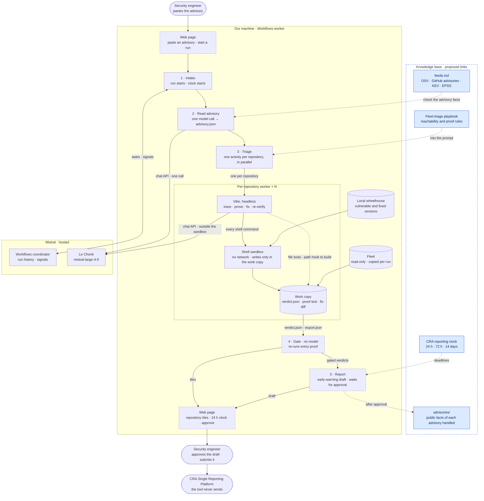
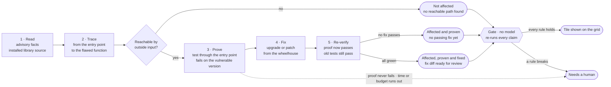

# System

The team is building a tool for the first 24 hours after a vulnerability is announced. This page is the knowledge base's summary of the team's own design, which lives on the branch `docs/system-design`. [Project brief, Nov 2026](sources/team-project-brief.md) [System design, Nov 2026](sources/team-system-design.md) It describes commit `c0211d4`. When the design changes, this page is out of date until it is ingested again.

## In one paragraph

When a serious vulnerability is announced in a library, a company has to answer one question quickly: which of our products are actually affected? The tool takes a security advisory, sends one agent into each repository, and returns a verdict per repository with proof. For an affected repository the proof is a test that triggers the flaw through the service's own entry point, fails before the fix and passes after it. For an unaffected one it is the reason, pointing at the code. The run ends with a draft of the regulatory early warning, which a person approves. [Project brief, Nov 2026](sources/team-project-brief.md)

## The system, with the knowledge base attached

How to read it: a run goes from top to bottom. The web page and the security engineer each appear twice, once at the start of a run and once at its end; each is one thing.

- **Solid boxes** ran in the team's test on 21 November 2026: the workflow, three agents in parallel, and the shell sandbox. [System design, Nov 2026](sources/team-system-design.md)
- **Dashed boxes** are designed and not built yet: the web page, the gate as code, and the report. The dashed arrow inside the worker is the gap the design names itself: file tools skip the shell sandbox until a second hook exists. [System design, Nov 2026](sources/team-system-design.md)
- **Blue boxes and dotted arrows** are not in the team's design. They are this knowledge base's proposal for where it plugs in, explained under "Where the knowledge base plugs in".

## What happens in a run

1. **Intake.** Someone pastes an advisory into the web page. The workflow starts, and so does the 24-hour clock. [System design, Nov 2026](sources/team-system-design.md)
2. **Read advisory.** One model call returns the library, the affected versions and the flawed function as `advisory.json`. [System design, Nov 2026](sources/team-system-design.md)
3. **Triage.** One activity per repository, all at once. Each works on a fresh copy of its repository, starts a headless Vibe process there and gets one attempt. [System design, Nov 2026](sources/team-system-design.md)
4. **Gate.** A check with no model in it re-runs each proof on the vulnerable and on the fixed version. A claim that fails becomes "needs a human". [System design, Nov 2026](sources/team-system-design.md)
5. **Report.** A template is filled from the verdicts that passed the gate, with no model call. The workflow then pauses until a person approves. That person submits the report; the tool never sends anything. [System design, Nov 2026](sources/team-system-design.md)

Mistral hosts the coordinator, which keeps the run's history. The team's worker process connects out to it and runs every step on the team's own machine. [System design, Nov 2026](sources/team-system-design.md)

## One worker's run

| Verdict | In `verdict.json` | Proof |
|---|---|---|
| Not affected | `not_affected` | The reason, and the code path followed up to where the trail stops. Worded "no reachable path found", never "safe" |
| Affected and proven | `affected_proven` | A test through the entry point that fails on the vulnerable version |
| Affected, proven and fixed | `affected_fixed` | The same test now passing, the old tests still passing, and a fix diff |
| Needs a human | `needs_human` | None. A timeout, a spent budget, or a claim the gate rejected |

The table and both diagrams follow the team's design. [System design, Nov 2026](sources/team-system-design.md) The reasoning behind them is on [Reachability and proof](concepts/reachability-and-proof.md).

## The verdict file

One `verdict.json` per repository. The agent writes its own fields and the orchestrator adds the rest. [System design, Nov 2026](sources/team-system-design.md)

| Field | Written by | Holds |
|---|---|---|
| `repo`, `advisory` | orchestrator | The repository name; the advisory id, package, affected range and flawed function |
| `verdict` | agent, then gate | One of the four values above. The gate can change it to `needs_human` and to nothing else |
| `reason` | agent | One paragraph. For `not_affected`, why no reachable path was found |
| `path` | agent | A list of file, line and note, from the entry point to the flawed function or to where the trail stops |
| `proof` | agent | A list of test IDs, with the expected result on the vulnerable and on the fixed version |
| `fix` | agent | The upgrade target or patch, and the name of the diff file |
| `suite` | agent | Passed and failed test counts before and after the fix |
| `follow_ups` | agent | Other bugs found along the way |
| `gate` | orchestrator | The result of each gate rule, from its own re-runs |
| `usage` | orchestrator | Tokens, cost, seconds and steps |

## Tested, designed, to build

| Part | State on 21 November 2026 |
|---|---|
| Workflow orchestration: parallel activities, pause for approval, resume after a crash | Tested |
| Per-repository agent, three in parallel, on one flaw in a fleet of three services | Tested: verdicts correct 3 of 3 |
| Shell sandbox: no network, writes only in the work copy | Tested: 47 of 47 shell commands sandboxed |
| Gate | Its checks were run by hand and passed. Not code yet |
| Path hook for file tools | To build |
| Web page, report | Designed, not built |
| Ten agents at once; the sandbox on Linux; the production design | Not tested |

The figures are the team's own. [Project brief, Nov 2026](sources/team-project-brief.md) [System design, Nov 2026](sources/team-system-design.md) The limits of that evidence are listed on [Reachability and proof](concepts/reachability-and-proof.md).

## Where the knowledge base plugs in

This is this knowledge base's proposal. None of it is in the team's design yet.

| Step | What it takes from the knowledge base | How it gets there |
|---|---|---|
| Read advisory | The queries in [Feeds](feeds.md), to check the model's reading of the advisory against the feed's record: identifiers, affected range, first fixed version, and whether the flaw is listed as exploited | The orchestrator runs on the host, which has a network |
| Triage | The rules and the verdict wording from [the fleet-triage playbook](playbooks/advisory-fleet-triage.md) and [Reachability and proof](concepts/reachability-and-proof.md) | Copied into the prompt file. The agent has no network and its web tools are off, so it cannot fetch pages itself |
| Gate | Nothing. The gate has no model, and its four rules are recorded on [Reachability and proof](concepts/reachability-and-proof.md) so that the page and the code can be compared | — |
| Report | The deadlines and the route for filing from [The CRA reporting clock](concepts/cra-reporting-clock.md) | Read when the template is written, and again when the law page changes |
| After approval | A new record in `advisories/` with the public facts of the advisory: the library, the versions, the flawed function, and any indirect route found | Written by a person or reviewed by one. This repository is public, so a record never names an affected repository or product |

Two rules for whoever wires this up:

- **Pin the knowledge base.** Text from this branch ends up in an agent's prompt, so it is a dependency like any other. Record the commit each run used.
- **Keep what it learns public-safe.** A map of unpatched vulnerabilities is among the most sensitive data a company holds. [Project brief, Nov 2026](sources/team-project-brief.md) Verdicts and proofs belong in the run's own evidence store, not here.

## Checked against this knowledge base

This is this knowledge base's reading of the design, set against its own pages.

- **Rule of Two: holds.** The per-repository agent reads untrusted input (the advisory and a third party's library source) and private data (the repository). The third leg is closed: no network for the shell, web tools off, and nothing leaves without the gate and a person. [System design, Nov 2026](sources/team-system-design.md) [Rule of Two, Nov 2025](sources/willison-rule-of-two.md)
- **The model call is the one route out.** Each agent talks to the hosted model from outside the sandbox, so repository code goes to Mistral in the demo. The production design closes this by running the model inside the boundary. [System design, Nov 2026](sources/team-system-design.md)
- **The filesystem wall has a hole until the path hook exists.** A sandbox needs both walls. [Claude Code sandboxing docs, undated](sources/claude-code-sandboxing-docs.md) File tools skip the shell sandbox, and the model API key sits in a `.env` file in the agent's home folder. [Project brief, Nov 2026](sources/team-project-brief.md) Until the hook is written, an agent that reads third-party code has a secret within reach.
- **The advisory is untrusted input too.** Its text is read by a model and the result goes into every agent's prompt. Checking `advisory.json` against the feed's record before the fan-out stops a wrong or planted value from spreading.
- **Logs and traces leave by default.** The worker sends them to Mistral unless `OTEL_ENABLED=false` is set. [Project brief, Nov 2026](sources/team-project-brief.md)
- **The 24-hour duty needs active exploitation.** The reporting duty is triggered by an actively exploited vulnerability or a severe incident. [Commission on CRA reporting, Sep 2026](sources/european-commission-cra-reporting.md) The flaw in the team's test is not in CISA's catalog of exploited vulnerabilities at version 2026.11.20. [CISA KEV, undated](sources/cisa-kev.md) So in the demo the clock is a premise. In real use, the read-advisory step can ask the catalog and say whether the clock applies.
- **"Fixed" means fixed for this advisory.** Upgrading Authlib from 1.8.0 to 1.9.0 fixes the test flaw, and 2 other advisories for 1.8.0 are fixed only in 1.9.1. [Authlib advisory, Oct 2026](sources/osv-authlib-ghsa-6v38-4h7w-rj9h.md) After a fix, asking the feed about the new version shows what is still open.

## In production

The same design inside a company's own cloud account or data centre. Only three things cross the boundary: new advisories come in, model calls go out only if the company chooses a hosted model, and the early warning leaves only when a person submits it. A feed watcher starts a run for every new advisory, and a dependency inventory picks the repositories that include the library. Each job runs in a container sandbox that covers the file tools too, holds no credentials, and reaches only a package mirror and a model gateway. Verdicts, proofs and report drafts go to an evidence store that cannot be silently changed. Fixes go out as draft pull requests, after the gate. [System design, Nov 2026](sources/team-system-design.md)

None of this was tested. [System design, Nov 2026](sources/team-system-design.md)

## Open in the design

- How many agents can run at once. Three did; ten has not been tried.
- The path hook for file tools.
- Whether the heartbeat shortens recovery after a crash.
- The gate as code.
- Which real open-source project joins the demo fleet.

These are the team's own open items. [System design, Nov 2026](sources/team-system-design.md)
